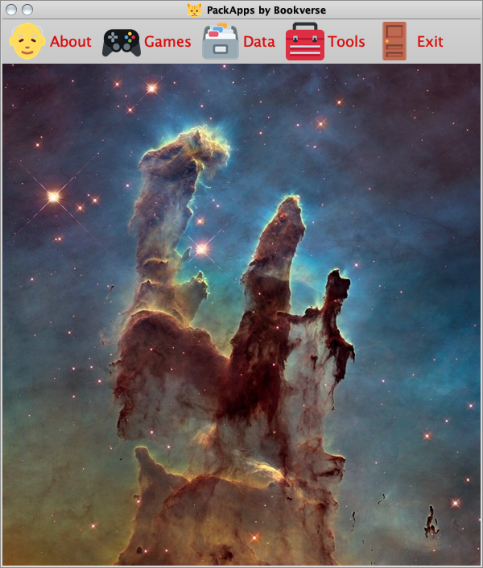
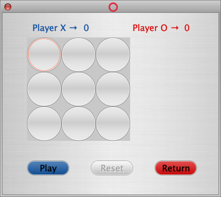

# PackApps by Bookverse

[English](README.md) · [Descargas](https://github.com/Moncada25/PackApps/releases) · [Contribuir](CONTRIBUTING.md)

PackApps nació en 2018 como proyecto universitario de Santiago Moncada. Desde el escritorio Swing puedes jugar ahorcado, dados, triqui, adivinanzas y rompecabezas. También puedes llevar las compras y ventas de una tienda, calcular notas, explorar estructuras de datos, reconocer texto en español e inglés, leer y crear códigos QR y exportar tablas a TXT, Excel XLS y PDF. Mantiene nueve temas y catorce fondos astronómicos.

## Instalación

En los archivos adjuntos de la versión 5 elige el paquete correspondiente. Todos incluyen Java 25 y el motor OCR. [GitHub Releases](https://github.com/Moncada25/PackApps/releases)

| Equipo | Archivo | Instalación |
|---|---|---|
| Windows x64 | `*-windows-x64.exe` | Ejecuta el instalador y abre PackApps desde Inicio. |
| Mac Apple Silicon | `*-macos-arm64.dmg` | Abre la imagen y arrastra PackApps a Aplicaciones. |
| Mac Intel | `*-macos-x64.dmg` | En «Acerca de este Mac» aparece procesador Intel. |
| Debian o Ubuntu x64 | `*-linux-x64.deb` | Ejecuta `sudo apt install ./PackApps-5.0.0-linux-x64.deb`. |
| Otros escritorios Linux x64 con glibc | `*-linux-x64.tar.gz` | Extrae el archivo y abre `PackApps/bin/PackApps`. |

Descarga SHA256SUMS. Compara el hash del archivo con sus 64 caracteres en la lista. Usa `shasum -a 256 ARCHIVO` en macOS, `sha256sum ARCHIVO` en Linux o `Get-FileHash ARCHIVO -Algorithm SHA256` en PowerShell. La firma ad hoc de macOS puede requerir autorización en Privacidad y seguridad. En Windows, SmartScreen puede indicar editor desconocido porque el instalador carece de firma Authenticode.

## Tus datos

La app crea SQLite en `~/.packapps/packapps.db`. Para una copia de seguridad, cierra la app y copia la carpeta completa. Puedes cambiar su ubicación con `PACKAPPS_HOME`. Al entrar por primera vez a datos protegidos o al registro de la tienda, elige y confirma una contraseña de ocho caracteres o más para ese rol. Los comentarios se guardan en la base seleccionada. El correo y WhatsApp usan servicios externos al accionarlos.

Para conectar MySQL, define `PACKAPPS_MYSQL_URL=jdbc:mariadb://HOST:3306/BASE`, `PACKAPPS_MYSQL_USER`, `PACKAPPS_MYSQL_PASSWORD`, `PACKAPPS_ADMIN_PASSWORD` y `PACKAPPS_MANAGER_PASSWORD` en el entorno de lanzamiento. Las cuentas antiguas requieren la clave de la instalación anterior en `PACKAPPS_LEGACY_KEY`. Una contraseña nueva se guarda con PBKDF2. Para una base nueva importa el [esquema limpio](src/main/resources/data/mysql.sql).

## Desarrollo

Con JDK 25 y JAVA_HOME configurado, ejecuta `./gradlew start` o `gradlew.bat start` en Windows. Ejecuta `./gradlew clean build` para compilar y probar. [Guía de releases](RELEASING.md) · [Licencia MIT](LICENSE) · [Créditos de terceros](THIRD_PARTY.md)
