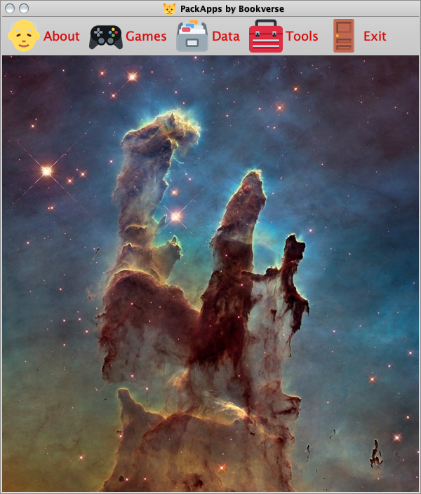
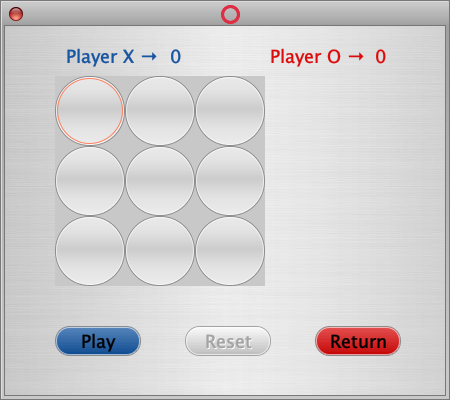

# PackApps by Bookverse

[Español](README.es.md) · [Releases](https://github.com/Moncada25/PackApps/releases) · [Contribute](CONTRIBUTING.md)

PackApps began in 2018 as Santiago Moncada’s university desktop project. Open a menu and play Hangman, roll the dice or challenge the tic-tac-toe CPU. The same Swing desktop holds a tiny shop, grade calculator, data structures, OCR and QR tools. Its nine looks and fourteen space wallpapers carry the original design into version 5.

## Install

Choose your file in **Assets** on the release page. Version 5 includes Java 25, SQLite and English and Spanish OCR. [GitHub Releases](https://github.com/Moncada25/PackApps/releases)

| Desktop | Download | Open |
|---|---|---|
| Windows x64 | `*-windows-x64.exe` | Run the per-user installer and open PackApps from Start. |
| Mac with Apple Silicon | `*-macos-arm64.dmg` | Open the disk image and drag PackApps to Applications. |
| Mac with Intel | `*-macos-x64.dmg` | Choose Intel if About This Mac lists an Intel processor. |
| Debian or Ubuntu x64 | `*-linux-x64.deb` | Run `sudo apt install ./PackApps-5.0.0-linux-x64.deb`. |
| Other Linux x64 desktops | `*-linux-x64.tar.gz` | Extract on a glibc-based desktop and run `PackApps/bin/PackApps`. |

Download SHA256SUMS alongside the package. On macOS use `shasum -a 256 FILE`, on Linux use `sha256sum FILE`, and on Windows use `Get-FileHash FILE -Algorithm SHA256`. Compare all 64 hexadecimal characters with the matching filename. macOS builds use an ad hoc signature, so Gatekeeper can ask you to allow the app in Privacy & Security. Windows SmartScreen can identify the publisher as unknown because the installer has no Authenticode signature.

## Explore the desktop

- **Games** includes Hangman, dice, Guess Number, sliding puzzles and tic-tac-toe with two players or the CPU.
- **Tools** includes grade calculations, arrays, stacks, queues, number and text utilities, bilingual image OCR, QR creation and reading, WhatsApp Web links and the inventory and sales simulator.
- **Data and Export** let you revisit records and export TXT, Excel 97–2003 XLS and PDF. The feedback form saves a comment in the selected database. Email and WhatsApp contact external services only when you use them.

## Data and first use

SQLite creates `~/.packapps/packapps.db` on launch. Set `PACKAPPS_HOME` to use a different directory. Close PackApps before copying the whole directory for backup or transfer. Keep it when replacing the application. QR images remain in `~/Documents/Bookverse/qr_codes`.

When opening protected data or registering a store user for the first time, enter a new admin or manager password of at least eight characters and confirm it. The two roles are separate. Set `PACKAPPS_ADMIN_PASSWORD` and `PACKAPPS_MANAGER_PASSWORD` in the launcher environment to supply them externally.

For an existing MySQL installation, set `PACKAPPS_MYSQL_URL=jdbc:mariadb://HOST:3306/DATABASE`, `PACKAPPS_MYSQL_USER` and `PACKAPPS_MYSQL_PASSWORD`, together with the role passwords above. For a new server import the [clean schema](src/main/resources/data/mysql.sql). Existing v4 users can use their previous installation’s encryption key via `PACKAPPS_LEGACY_KEY`. Changing the account password writes a salted PBKDF2 hash. Selecting MySQL keeps data on that server.

## Build from source

Install JDK 25, set JAVA_HOME and run `./gradlew start` or `gradlew.bat start`. Run `./gradlew clean build` for automated tests. Packaging runs on the destination OS. [Release guide](RELEASING.md)

PackApps source is MIT licensed. The artwork, runtime and bundled libraries have their own credits and terms. [License](LICENSE) · [Third-party credits](THIRD_PARTY.md) · [Security](SECURITY.md)
